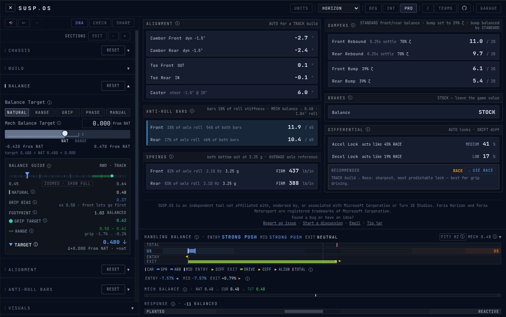

# SUSP.OS — Suspension Tuning Calculator

[](https://solocandy.github.io/susp-os/)
[](LICENSE)

A single-file suspension tuning calculator for **Forza Horizon**, **Forza Motorsport**, and **BeamNG.drive**. Enter your car's physical stats and a handling target — SUSP.OS outputs values for springs, dampers, anti-roll bars, alignment, brakes, and differential, all grounded in real suspension physics: exact in-game clicks for the Forza titles, and real physical units (N/m, N/m/s) for BeamNG.

> Physics approach based on [NumberlessMath's Forza Suspension Calculator (2020)](https://docs.google.com/spreadsheets/d/1ySrVkgQpohIduhdLCwe99p3d6KmWXKgck5Uk-qDOlPw/edit?usp=sharing)



**Contents:** [Quick Start](#quick-start) · [What It Does](#what-it-does) ·
[Complexity Tiers](#complexity-tiers) · [Architecture](#architecture) ·
[Documentation](#documentation) · [Development](#development) ·
[Compatibility](#compatibility) · [Feedback](#feedback) ·
[AI Use](#ai-use) · [Credits](#credits) · [License](#license)

---

## Quick Start

**[Open the live app](https://solocandy.github.io/susp-os/)** — or download `index.html` and open it in any browser. No install, no server, no build step. A downloaded copy checks the live site while online, and the GitHub button in its header turns green (↓) once a newer version is out.

> **Offline note:** React and Babel load from a CDN on first use. After that the app keeps its compiled code in the browser and works fully offline, and repeat visits skip Babel entirely. For a fully air-gapped setup, open it once with internet access, then it works without a connection.

---

## What It Does

Game tuning menus expose raw numbers — spring rates, damper settings, ARB clicks — with no guidance on what those numbers mean physically. SUSP.OS bridges that gap:

1. **You describe your car** — weight, front weight bias, drivetrain layout, and build type. From INT mode: tyre sizes, and CG height, estimated from ride height and tyre radius by default, or entered manually. In PRO mode: wheelbase, and track widths for full chassis geometry.
2. **You set a handling target** — ride stiffness, mech balance target (how rear-biased the roll stiffness should be for your drivetrain and build), damping character, and differential intent. In PRO, the balance guide shows a recommended range for your layout and build type — a band of at-limit understeer or oversteer measured from your chassis's grip-neutral point, so build types keep the same order on every car — and flags how far your chassis's natural balance sits from the target.
3. **SUSP.OS computes the physics** — spring rates from natural frequency targets, damper clicks from critical damping coefficients, ARB split solved to hit your mech balance target, alignment geometry, brake bias, and differential lock percentages.
4. **You enter the output values into your game's tuning menu** — springs, dampers, ARBs, alignment, brakes, and differential: exact clicks for the two Forza titles, real physical units for BeamNG. Each output card's header says in words how its values were reached (in Forza, for example "AUTO stiffness · MECH balance → 0.60 · 1.90° roll"), each row brightens the figure its mode aims at, and a warning under a card says when a target was out of reach and which control to move; in Forza those warnings are also listed at the top of the panel, one line each, linking to their card. Values the last change moved are marked with a blue edge until the next change, so after an edit you know which ones to retype.

The result is a tune that starts from a principled baseline rather than trial-and-error guessing.

### Around the app

**Header.** The **?** button reopens the current tier's guide. **TERMS** opens a searchable glossary (Hz, ζ/damping ratio, ARB, mech balance, camber/toe/caster, and more), grouped like the app's own sections; it opens on ALL, and BEG / INT / PRO chips narrow it to one tier and below, with INT or PRO badges on paragraphs that only apply higher up. Most ⓘ tooltips, and several guide steps, end in a **TERMS: … ›** link to the full entry. The GitHub mark opens this repository — and when a newer version is published while the page is open, it turns green with a ↻ and reloads the page instead (your tune and garage are kept).

**Inputs.** Every slider's value can be typed as well as dragged, in the number box beside its label.

**Toolbar.** **⟲ RESET / ↩ / ↪ / DNA / CHECK / SHARE** is pinned to the top of the sidebar in every tier.
- ⟲ clears the tune or the tutorials back to defaults (garage saves are untouched).
- ↩ / ↪ undo and redo (Ctrl+Z, Ctrl+Shift+Z or Ctrl+Y; ⌘ on Mac). A slider drag is one step; so is each load, APPLY, share-code import or reset.
- **DNA** (PRO) opens the Vehicle DNA editor and your saved DNAs.
- **CHECK** opens Tune Check, a reverse calculator that reads frequencies and damping ratios back out of existing spring/damper values and imports them as a tune, or (PRO) as a Vehicle DNA. From INT it also imports an existing alignment into ALIGNMENT's MANUAL.
- **SHARE** handles share codes and JSON garage backups.

**VISUALS.** A collapsible card pinned to the bottom of the sidebar holds every readout and graph, in independently collapsible groups, so they stay visible whichever input section is open:
- **DNA MATCH** — only while a Vehicle DNA is linked: each axis's target against the tune's current value.
- **RIDE · ROLL · DAMPING** — the front/rear roll-stiffness split (springs vs ARBs, with NAT and target ticks), body roll and ARB share, then ride Hz, ARB and bump/rebound damping on one shared scale per quantity.
- **DYNAMICS** — a damped step response per axle with a ±10% settle band, settle-time marker and first-neutral-crossing ring, all measured off the drawn curve.
- **SAG** — sag vs load, when RIDE HEIGHT → CG is active.
- **ALIGNMENT** — Forza modes: camber against body roll with the build's target, and each alignment value on its range beside AUTO's.

What every scale, band, marker and colour means is in [VISUALS.md](docs/VISUALS.md).

**GARAGE.** A drawer that slides out from the right (header button, every tier) and holds everything you save. Each entry is a **chassis**, a **build** (feel + diff tune), or a **car** carrying both — a car has separate LOAD CHASSIS and LOAD BUILD buttons, so you can mix one car's chassis with another's tune, and every load is undoable. Entries take notes and your own tags, and get automatic ones (drivetrain, weight balance, stiffness band, build type, diff type and MANUAL DIFF, brake bias shift and Centre, applied DNA, saved tier) that you can search on, alongside filter-by-kind and sort. Every entry has a COPY CODE button. The six factory presets are pinned read-only at the top.

**Share codes.** SHARE gives you a **code** and a **link** (`…#t=CODE`) for the current tune; opening a link is the same as pasting the code. Either way the code is **staged, not applied** — READ CODE shows what it carries, part by part (CHASSIS · SPRINGS · DAMPERS · ARB · DRIVETRAIN · ALIGNMENT), tagging the parts that already match yours, and nothing moves until **APPLY SELECTED** takes the parts you ticked. With nothing staged the ticks summarise your own values. **DISCARD** throws a staged code away; **TO GARAGE** saves it as a new garage entry without touching what you're working on. Garage loads stay whole-tune. Every field a code carries belongs to exactly one part — see [docs/CODEC.md](docs/CODEC.md).

---

## Complexity Tiers

A **BEG / INT / PRO** toggle in the header controls how much of the input surface is visible. A short in-app guide opens the first time you enter each tier, pointing at the exact controls, result cards and balance-bar parts it describes.

INT and PRO unlock as you go: INT once you've opened the BEG guide, PRO once you've opened the INT guide. Until then their header buttons show a 🔒, and clicking one opens the guide that unlocks it.

INT and PRO can also hide what you don't use. **EDIT** in the sidebar's SECTIONS row switches to an edit view: use a section's **HIDE** button, or click any single control, toolbar button (DNA, CHECK), output card or row, or part of the balance bar to grey it out, click again to bring it back, and **DONE** to return. INT and PRO keep separate lists, saved on this device only. Hiding never changes the tune: a hidden section or control whose settings differ from their defaults leaves one line on its section (*N hidden settings changed · still apply · SHOW*), warnings are never hidden, and the output panel notes how many of its parts are hidden. The in-app guides show everything while they run. Turn on **PERSIST** (above the edit banner) and whatever is hidden in your current tier also keeps its value: presets, garage loads, LOAD CODE, DNA and RESET leave it alone, and a line says what was kept. Hide the ANTI-ROLL BARS set to MAN 1 / 65, for instance, and they stay 1 / 65.

Every slider's range, tier and handling effect is in [SLIDERS.md](docs/SLIDERS.md).

| Tier | Surface |
|---|---|
| **BEG** | <ul><li>Layout, build type (Street / Track / Drift / Rally / Offroad / Drag), weight, and front bias</li><li>Three feel sliders: Ride Stiffness, Balance, Character</li><li>Factory presets in the GARAGE, with ★ on the one matching your build type</li><li>ARB balance set automatically for your layout and build</li><li>Full GARAGE access</li></ul> |
| **INT** | All BEG inputs, plus: <ul><li>**BRAKES**: Brake Bias shifts the recommendation up to 10 points toward STABLE or ROTATE; **STOCK** drops the brakes out of every calculation</li><li>A **three-phase Handling Balance** headline: ENTRY · MID · EXIT as PUSH / NEUTRAL / LOOSE</li><li>**ALIGNMENT**: AUTO moved by five intent sliders, or MANUAL for an alignment already in the game</li><li>ARB stiffness modes AUTO / BASIC / ROLL ° / SHARE % / **MAN** (front/rear ARB values entered directly — clicks in Forza, N/m in BeamNG), with ARB Bias</li><li>ARB balance modes WEIGHT / NEUTRAL, with **Split Direction** (SAME / OPPOSITE) under WEIGHT</li><li>Per-axle ride frequency and damping: SETTLE TIME, REBOUND / BUMP MODE, **BUMP BALANCE**, and BUMP MODE **LANDING** (bump ζ solved from a drop height)</li><li>**RIDE REF.** (FRONT / SHARED / REAR) and **Hz MODE** (MULTIPLIER / FLAT RIDE / INDEPENDENT)</li><li>**STIFFNESS** HZ / BOTTOM G's, which also unlocks the **SHARED** Hz mode</li><li>Drivetrain intent sliders, and **Diff Type** (Race / Sport / Rally / Offroad / Drift, Forza Horizon only) with a recommended type per build</li><li>**Tyre sizes**, and **CG Height Source** (RIDE HEIGHT with a SAG vs LOAD chart, or MANUAL)</li></ul> |
| **PRO** | All INT inputs, plus: <ul><li>Balance guide, chassis balance / grip bias / stability readouts, and Mech Balance Target with five modes: NATURAL / RANGE / GRIP / PHASE / MANUAL</li><li>BRAKES **Centre**: shift from REC or GRIP, or ENTRY for a trail-braking target</li><li>A **phase-based Handling Balance**: grip-margin % at ENTRY, MID and EXIT</li><li>ARB balance modes **CHASSIS** / MECH / CO-SOLVE, with CO-SOLVE's **Auto Spring Share** and a wheel-lift warning past ×1.20 rear/front Hz</li><li>Hz MECH mode</li><li>Full chassis geometry (wheelbase, track widths) and per-wheel load transfer readouts</li><li>Differential **MANUAL** mode, and for AWD a **Split Mode** with **SOLVE EXIT**</li><li>Calibration: **measured natural balance**, and (Forza only) **measured ARB scale**</li><li>**Vehicle DNA**: a portable handling personality that APPLY solves onto this car</li><li>In **BEAMNG** mode: **Motion Ratio F / R** and **ARB Motion Ratio F / R**</li></ul> |

---

## Architecture

The entire app is a single HTML file: a pure-JS physics engine
(`solveTune`: `feelToPhysics` → `computeTune`, then `computeDiff`/`computeAlignment`), a React
UI transpiled in-browser via `@babel/standalone` (once per version — the output is cached
in IndexedDB), `localStorage` persistence,
and a sparse Base64 share codec. No build step, no server.

A **HORIZON / MOTORSPORT / BEAMNG** dropdown in the header picks which game's
tuning menu the output is written for. It changes *units, ceilings, and the
increments each game's sliders snap to* — the underlying physics solve
(spring/damper/ARB targets, handling balance, alignment) is the same one in all
three. Each mode then quantises that solve to its own grid and reports the
physics of the quantised value, so the Hz, ζ and balance figures printed beside
an output row describe the tune you can actually dial in rather than the
pre-rounding target. Because the grids differ, identical inputs give very
slightly different balance readouts between modes; that is correct, not drift.

**Horizon and Motorsport** express output as abstract 1–N "clicks," because
that's what those games' tuning screens use — Forza hides the real internal
units, so each has its own click ceiling (Horizon: 65 ARB / 20 damper.
Motorsport: 40 / 40). **BeamNG** has no such fixed scale — it builds its
tuning sliders per-vehicle from the car's own config — so that mode skips the
click conversion and outputs the real values directly: spring rate in N/m,
damping in N/m/s, anti-roll rate in N/m, each snapped to the increment BeamNG's
own slider moves in (500 / 100 / 1000).

Other things specific to BEAMNG mode:
- **Motion ratios (PRO):** **Motion Ratio F / R**, **ARB Motion Ratio F / R** and **Damper MR F / R**
  (SAME as the spring's, or its own), because BeamNG's sliders act at the spring, damper and the
  bar's own lever rather than at the wheel.
- **JBEAM ADJUST (PRO):** for cars whose jbeam changes the menu value on its way to the physics
  (`$=$damp_bump_R - 1000`), a scale and offset per output so the printed number lands. Tune Check
  and the ARB MAN entry undo it too.
- **Anti-roll is the least-validated output.** Until the ARB ratio is set, each Anti-Roll row also
  prints a `≈` rate at a typical 0.45 arm ratio, in every tier.
- **BASIC ARB stiffness** is Forza-only and hidden.
- **Layout:** the output follows BeamNG's own menu grouping in two columns (front left, rear
  right), and the sidebar names the mode.
- **Units:** the UNITS dialog disables the spring-rate choice, since BeamNG always uses N/m.

Full detail — the unit table, all behavioural differences from Forza, and why no new calibration
constant was needed — is in PHYSICS.md's
[**Physical-unit output**](docs/PHYSICS.md#physical-unit-output-beamng-game-mode) section.

---

## Documentation

Reference docs for maintainers:
- [CODE_MAP.md](docs/CODE_MAP.md) — how `index.html` is laid out, and which legacy code must not be deleted
- [SLIDERS.md](docs/SLIDERS.md) — every slider's range, tier, physical effect, and oversteer/understeer direction
- [PHYSICS.md](docs/PHYSICS.md) — Hz/spring/damping solve math (Ride Stiffness → spring rate/clicks, Hz modes, settle time, the LLT grip model) and the empirical calibration constants
- [FORMULAS.md](docs/FORMULAS.md) — the ground-truth handling-balance contributor formulas
- [ALIGNMENT.md](docs/ALIGNMENT.md) — camber/toe/caster target formulas and per-build/layout baselines
- [CODEC.md](docs/CODEC.md) — the share-code field ID table (never reuse an id)
- [PERSISTENCE.md](docs/PERSISTENCE.md) — localStorage keys and when to bump a version
- [PRESETS.md](docs/PRESETS.md) — factory preset values and how to add a new one
- [VISUALS.md](docs/VISUALS.md) — the pinned VISUALS card: what each group plots, its scales and bands, and what every marker and colour means
- [DNA.md](docs/DNA.md) — Vehicle DNA, a chassis-portable handling personality compiled into a tune (PRO, in the DNA modal on the sidebar toolbar)
- [TUTORIALS.md](docs/TUTORIALS.md) — the guided tours: every step and its text word for word, when each guide opens, tier gating, spotlight/positioning, and how to add a step
- [HINTS.md](docs/HINTS.md) — every ⓘ hint and piece of inline guidance, word for word, grouped by where it appears
- [KNOWN_ISSUES.md](docs/KNOWN_ISSUES.md) — open gaps, deliberate limitations kept with their reasoning, and designs considered and rejected
- [IDEAS.md](docs/IDEAS.md) — parked designs, not implemented or scheduled (AUTO Balance Mode)
- [HISTORY.md](docs/HISTORY.md) — resolved incidents, kept because the reason each one broke is worth remembering

---

## Development

No build tools required. Open `index.html` in a browser, edit with any text editor, reload to see changes.

```
node tests/tests.js          # physics unit tests (mirrored copy, cross-checked against index.html)
node tests/tests-beamng.js   # physical-unit mode tests (reads index.html directly)
node tests/tests-docs.js     # documentation drift checks (reads index.html and docs/)
node tests/tests-dna.js      # Vehicle DNA core tests (reads index.html directly)
node tests/tests-history.js  # undo / redo history core tests (reads index.html directly)
node tests/tests-share.js    # share parts: a code loads in pieces (reads index.html directly)
node tests/tests-ride.js     # Ride Reference: CO-SOLVE inversion, RIDE REF. switch, BOTTOM G's (reads index.html directly)
node tests/tests-balance.js  # mech-balance model properties (reads index.html directly)
node tests/tests-garage.js   # garage auto-tags and their tier gating (reads index.html directly)
node tests/tests-sections.js # layout edit view: section and control ownership, hidden-change gating, stored lists; guide step spots and resume points (reads index.html directly)
```

GitHub Actions runs every suite in `tests/` on each push to `main` and each pull
request (`.github/workflows/tests.yml`). It doesn't load the page, so the browser
is still the check for anything the UI does.

`tests-docs.js` fails when a fact stated in the docs stops matching the code:
a codec id table that has drifted, an enum value no doc mentions, a storage key
that vanished, a slider range that contradicts what `sanitizeTune` actually
clamps to, a collapsible section missing from the `open` state, or a broken
link between docs. It checks names, ids, keys and numbers — never prose — so a
green run means the facts line up, not that the writing is still accurate.

---

## Compatibility

- **Desktop:** Chrome/Edge 105+, Firefox 121+, Safari 15.4+
- **Mobile:** iOS Safari 15.4+ (iPhone/iPad), Android Chrome 105+
- Older browsers back to Chrome/Edge 87 and Safari 14.1 run the app, but the in-app guides can't fade the parts of the page they aren't pointing at (that needs CSS `:has()`)
- Works fully **offline** after first load
- Nothing to install: no build step, no Node.js, no package manager (React and Babel come from a CDN)

---

## Feedback

- **Found a bug or something looks wrong?** [Open an issue](https://github.com/SoloCandy/susp-os/issues/new/choose) — a share code (SHARE → COPY CODE) makes it much easier to reproduce.
- **Have an idea or a question?** [Start a discussion](https://github.com/SoloCandy/susp-os/discussions).
- **Prefer email?** [soloc4ndy@gmail.com](mailto:soloc4ndy@gmail.com).

---

## AI Use

Most of the code, tests and documentation in this repository were written by
[Claude](https://www.anthropic.com/claude), Anthropic's AI model, through Claude Code — commits
authored by `Claude` or carrying a `Co-Authored-By: Claude` line are its work. The project's
direction, feature decisions, review and in-game testing are done by the maintainer.

What that means for you:
- **The physics is grounded, not invented.** The solve follows NumberlessMath's published
  calculator (see [Credits](#credits)), and the key calibration constants in
  [PHYSICS.md](docs/PHYSICS.md) come from in-game and telemetry measurement, not from the
  model. The ones that aren't calibrated yet are marked as such.
- **Plausible-looking isn't the same as correct.** The test suites check the code and the docs
  against each other, but only driving a tune in the game shows whether it works. Where in-game
  testing found a miss, it's written down in [KNOWN_ISSUES.md](docs/KNOWN_ISSUES.md).
- **If a number looks wrong, it may well be.** [Open an issue](https://github.com/SoloCandy/susp-os/issues/new/choose)
  with a share code.

---

## Credits

- Physics foundation: [NumberlessMath](https://docs.google.com/spreadsheets/d/1ySrVkgQpohIduhdLCwe99p3d6KmWXKgck5Uk-qDOlPw/edit?usp=sharing) (2020)

---

## License

MIT
